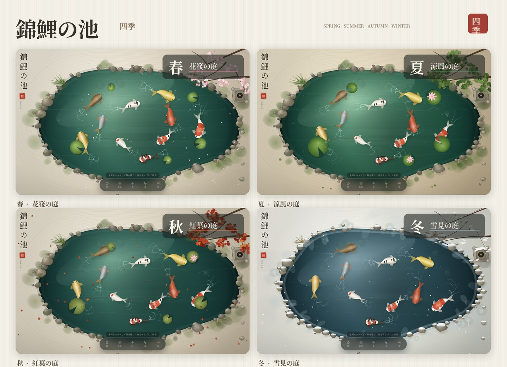
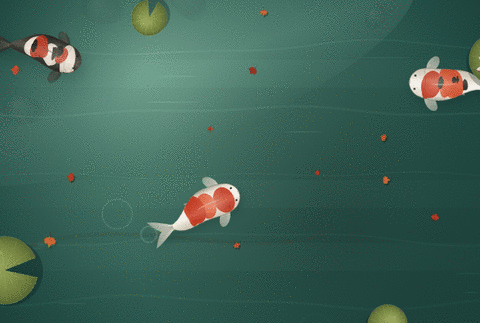

# 錦鯉の池 · 可交互日式锦鲤池

一个纯静态的俯视锦鲤池：撒饵喂鱼、点击观鱼、拖动划水，并在春夏秋冬四套庭院景色之间切换。单文件 HTML，离线可用，无后端、无外部依赖。





## 功能

- **撒饵**：轻点水面落下饵料，附近的锦鲤会转向、加速并聚拢抢食。
- **认鱼**：轻点任意一条鱼，查看品种、全长与所处水深。
- **划水**：在水面拖动可划出连续涟漪，鱼会短暂避让。
- **四季**：春樱、夏荷、秋枫、冬雪四套场景，背景约 1.15 秒交叉淡入，睡莲、漂浮物、粒子和光线同步更新。
- **昼夜与声音**：可切换夜色与虫鸣水声，默认静音。
- **自适应**：桌面宽屏与手机竖屏、窄屏、横屏均已适配。

### 四季

| 季节 | 庭院 | 主要景物 |
|:--|:--|:--|
| 春 | 花筏の庭 | 樱花满枝、落瓣漂流、嫩叶浮水 |
| 夏 | 涼風の庭 | 浓绿树冠、睡莲盛开、蜻蜓低飞 |
| 秋 | 紅葉の庭 | 红枫落叶、暖光、残余一朵睡莲 |
| 冬 | 雪見の庭 | 枯枝覆雪、岸石积雪、薄冰与雪粒 |

## 操作

- 轻点水面：撒饵
- 轻点鱼：查看信息
- 拖动水面：划出波纹
- 底部按钮：`餌` 撒饵 · `波紋` 涟漪 · `四季` 换季 · `夜` 昼夜 · `音` 声音
- 键盘：`F` 撒饵、`R` 波纹、`S` 换季、`1`–`4` 选春夏秋冬、`N` 昼夜、`M` 声音、`D` 骨骼调试

## 水面与鱼尾

鱼尾只留下向外扩散的圆形波纹：早期是一层很宽的淡晕，随后是细亮环，并随扩散逐渐消失。没有放射状尾迹或 V 形水痕；尾圈颜色压得很浅，深水鱼更弱，不抢睡莲、岸石和季节景色的视觉重心。环境涟漪、投饵和拖拽波纹保持更清晰的层次。

## 技术

- 原生 HTML / CSS / JavaScript + Canvas 2D，无框架、无构建依赖。
- 单文件：HTML、样式和脚本全部内联，约 111 KB。
- 鱼体为程序化绘制：脊椎行波推进、鳍位与斑纹裁剪、平滑限速转向、边界约束与投饵寻食。
- 背景、岸石、植物和季节元素均按季节预渲染后交叉淡入，避免逐帧重绘。

## 验证

- 确定性模拟无 NaN，鱼始终留在池内（归一化半径 ≤ 0.86）。
- 投饵后快速转向并完成进食。
- 四季切换、尾圈生成、鱼信息卡、声音与昼夜按钮均正常，无控制台错误。
- 390×844、360×740、844×390 三档布局无横向或纵向溢出。

## 部署

将 `index.html` 放到静态目录，例如：

```bash
mkdir -p /path/to/site/static/koi-pond
cp index.html /path/to/site/static/koi-pond/
```

访问：

```text
https://your-domain/static/koi-pond/
```

也可直接双击 `index.html` 本地打开。
