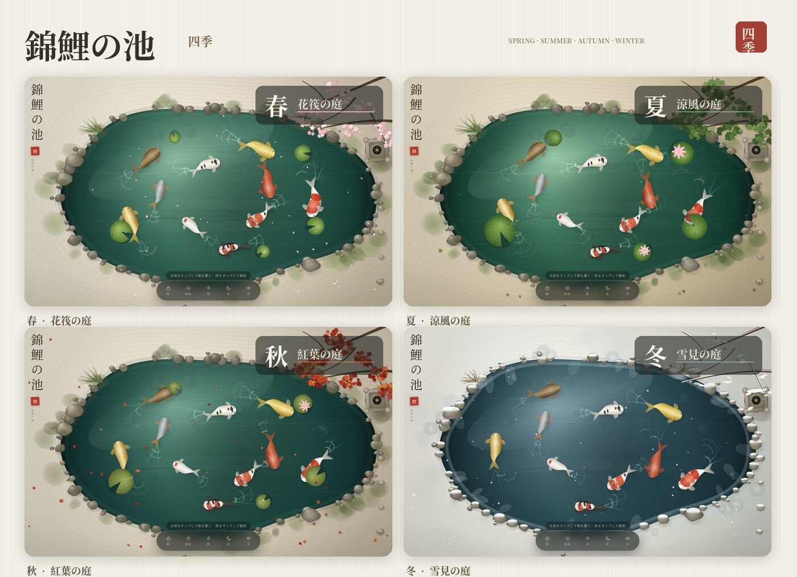
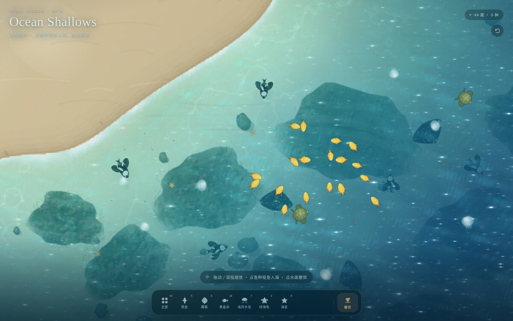

# 錦鯉の池 · 双场景（锦鲤池 / 海岛浅滩）

一个纯静态的俯视双场景小项目：在日式锦鲤池与热带海岛浅滩之间一键切换。两个场景各自是单文件 HTML，离线可用，无后端、无外部依赖。

右上角 `錦鯉 / 海島` 切换场景：锦鲤池保留四季庭院，海岛浅滩可以投鱼入海、撒饵、拖动和缩放。

## 场景

### 錦鯉の池



- **撒饵**：轻点水面落下饵料，附近的锦鲤会转向、加速并聚拢抢食。
- **认鱼**：轻点任意一条鱼，查看品种、全长与所处水深。
- **划水**：在水面拖动可划出连续涟漪，鱼会短暂避让。
- **四季**：春樱、夏荷、秋枫、冬雪四套场景，背景约 1.15 秒交叉淡入，睡莲、漂浮物、粒子和光线同步更新。
- **昼夜与声音**：可切换夜色与虫鸣水声，默认静音。

### 海島 · Ocean Shallows



- **投鱼入海**：点击底部鱼种按钮，把鹰鳐、燕鱼、黄金吊、海月水母、绿海龟、海星抛入礁湖，落水时溅起水花、泡沫与扩散波纹。
- **撒饵**：轻点水面撒下饵料，鱼群会游向饵料。
- **探索**：拖动画面平移，双指缩放或滚轮缩放，右上角按钮重置视角。
- **水面**：浅海深度渐变、太阳光带、方向波法线、岸线碎浪泡沫、动态焦散与三层不规则波光。
- **移动端**：竖屏与横屏自适应；纹理降采样、实体数量上限、后台暂停渲染，并支持 WebGL 上下文丢失后的自动恢复。

## 操作

| 场景 | 操作 |
|:--|:--|
| 锦鲤池 | 轻点水面撒饵 · 轻点鱼查看信息 · 拖动划出波纹 · 底部 `餌 / 波紋 / 四季 / 夜 / 音` |
| 海岛 | 点击鱼种投鱼 · 轻点水面撒饵 · 拖动 / 双指缩放 · 右上角重置视角 |
| 通用 | 右上角 `錦鯉 / 海島` 切换场景 |

锦鲤池键盘：`F` 撒饵、`R` 波纹、`S` 换季、`1`–`4` 选春夏秋冬、`N` 昼夜、`M` 声音、`D` 骨骼调试。

## 水面与鱼尾

锦鲤池的鱼尾只留下向外扩散的圆形波纹：早期是一层很宽的淡晕，随后是细亮环，并随扩散逐渐消失。没有放射状尾迹或 V 形水痕；尾圈颜色压得很浅，深水鱼更弱，不抢睡莲、岸石和季节景色的视觉重心。海岛水面则使用方向波法线、Fresnel 天空反射、太阳光带与岸线泡沫，波光集中在阳光路径附近。

## 技术

- **锦鲤池**：原生 HTML / CSS / JavaScript + Canvas 2D，单文件约 113 KB。鱼体为程序化绘制：脊椎行波推进、鳍位与斑纹裁剪、平滑限速转向、边界约束与投饵寻食；背景、岸石、植物和季节元素按季节预渲染后交叉淡入。
- **海岛**：单文件 Three.js（r149，内联）WebGL 场景，约 727 KB。正交俯视相机、Canvas 程序化海床与鱼群贴图、自定义水面/焦散着色器。
- **切换**：两个页面通过右上角链接互相跳转，不依赖路由或服务端；直接双击任一 HTML 也可离线运行。

## 验证

- 锦鲤池：确定性模拟无 NaN，鱼始终留在池内；四季、尾圈、鱼信息卡、昼夜与声音正常。
- 海岛：投鱼、全部投掷、撒饵、拖动缩放正常；WebGL 上下文丢失后能自动恢复并重建材质。
- 场景切换：1440×900、390×844、320×640、844×390 双向往返测试通过，无横向/纵向溢出，无控制台错误。

## 文件

- `index.html` — 锦鲤池单文件页面。
- `island.html` — 海岛浅滩单文件页面。
- `seasons.jpg` — 锦鲤池四季对照。
- `island.jpg` — 海岛浅滩预览。
- `preview.gif` — 锦鲤池全景动态预览。
- `swim.gif` — 锦鲤游动与尾圈近景。

## 部署

把整个 `KoiPond/` 目录放到静态目录，例如：

```bash
mkdir -p /path/to/site/static/koi-pond
cp -r KoiPond/* /path/to/site/static/koi-pond/
```

访问 `https://your-domain/static/koi-pond/`，右上角即可切换海岛场景（`island.html`）。也可直接双击 `index.html` 本地打开。
