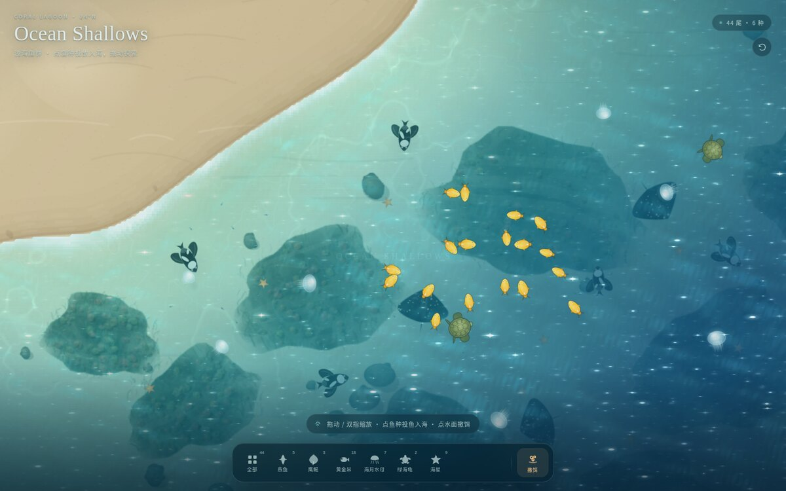

# Ocean Shallows · 海岛浅滩

一个纯静态、俯视视角的可交互热带海岛浅滩：把鱼种抛入礁湖、撒饵、拖动探索。单文件 HTML，离线可用，无后端、无外部依赖。

右上角 `錦鯉 / 海島` 可切换到相邻的锦鲤池场景（`../KoiPond/index.html`）。



## 功能

- **投鱼入海**：点击底部鱼种按钮，把鹰鳐、燕鱼、黄金吊、海月水母、绿海龟、海星抛入礁湖；落水时溅起水花、泡沫与扩散波纹。
- **撒饵**：轻点水面撒下饵料，鱼群会游向饵料。
- **探索**：拖动画面平移，双指缩放或滚轮缩放，右上角按钮重置视角。
- **水面**：浅海深度渐变、太阳光带、方向波法线、Fresnel 天空反射、岸线碎浪泡沫、动态焦散与三层不规则波光。
- **移动端**：竖屏、窄屏与横屏自适应；纹理降采样、实体数量上限、后台暂停渲染，并支持 WebGL 上下文丢失后的自动恢复。

## 操作

- 点击底部鱼种：投鱼入海
- 底部 `全部`：一次投放全部 6 种
- 轻点水面：撒饵
- 拖动 / 双指缩放：探索礁湖
- 右上角 `錦鯉`：切换到锦鲤池

## 技术

- 单文件 Three.js（r149，内联）WebGL 场景，约 727 KB。
- 正交俯视相机、Canvas 程序化海床与鱼群贴图、自定义水面/焦散着色器。
- 移动端按设备分级限制 DPR、纹理尺寸、鱼群/水花/波纹数量；桌面保留更高精度海床。

## 验证

- 投鱼、全部投掷、撒饵、拖动缩放正常。
- WebGL 上下文丢失后能自动恢复并重建材质。
- 390×844、320×640、844×390 布局无横向/纵向溢出，无控制台错误。

## 部署

将 `KoiPond/` 与 `OceanShallows/` 放在同一个静态父目录下：

```bash
mkdir -p /path/to/site/static
cp -r KoiPond OceanShallows /path/to/site/static/
```

访问 `https://your-domain/static/OceanShallows/`。两个目录需保持同级，场景切换使用相对路径。也可直接双击 `index.html` 本地打开。
