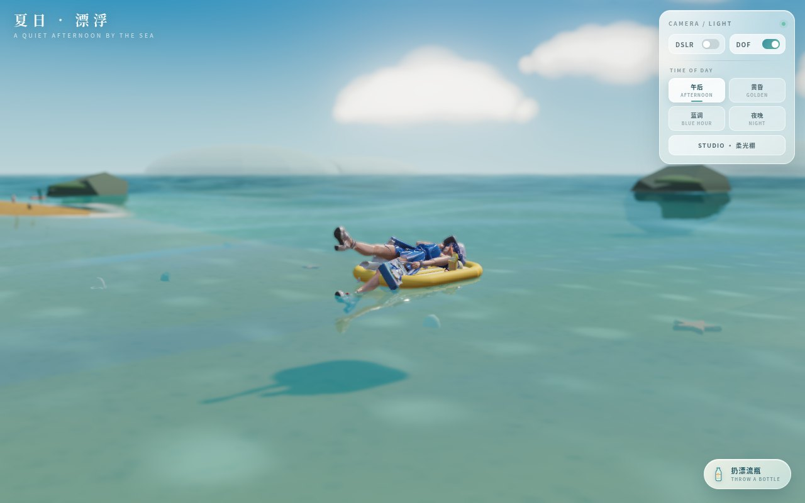

# Summer Drift · 夏日漂浮

一个纯前端、单文件的海边夏日场景：蓝发女孩躺在柠檬色气垫上随浪漂浮，喝着冰柠檬茶。可自由环视、切换时段光照，扔出漂流瓶后她会游过去把信捡回来，读给你听。Three.js WebGL，无后端。

## 功能

- **气垫漂浮**：女孩躺在充气垫上，跟随真实波高起伏、随浪倾斜，并带弹簧阻尼的漂移和落水涟漪。
- **柠檬茶**：垫上有玻璃杯、冰块、气泡、柠檬片和薄薄荷；吸管每帧重新指向嘴部骨骼，喝的时候杯子会轻轻倾斜。
- **视角**：拖拽环视 / 滚轮或双指缩放，`WASD` 平移探索，双击回到女孩。
- **光照**：午后 / 黄昏 / 蓝调 / 夜晚 / 柔光棚五套预设，带 SSAO、景深、Bloom、色调映射与 DSLR 暗角。
- **漂流瓶**：随机方向与力度的投掷、真实水花与波纹；女孩察觉、翻身下水、游过去捡瓶、上岸读信、回到气垫，全程骨骼动画混合。
- **信件**：羊皮纸信件逐字浮现，可收进口袋，同时切换回漂浮状态。
- **移动端**：竖屏自适应，按设备降 DPR 与后期精度，后台暂停渲染。

## 操作

- 拖拽 / 双指：环视与缩放
- `WASD` / 方向键：平移视角
- 右上角面板：DSLR、景深、时段切换
- 右下角 `扔漂流瓶`：触发整段剧情

## 技术

- 单文件 Three.js（r0.160，importmap + unpkg CDN）页面，约 2.6 MB，内含 base64 编码的骨骼模型。
- 19 根骨骼的角色，`Float` / `Swim` 两段动画按权重混合；皮肤权重按连通块锁定，避免关节拉扯。
- 自定义水面着色器（多层波纹、Fresnel、天空反射、焦散）、程序化气垫（管道圆环 + 挤出甲板）、世界坐标吸管两段对位。
- 后期：EffectComposer + SSAO + Bokeh 景深 + UnrealBloom + DSLR。

## 验证

- 1280×800 与 390×844 下无控制台错误，完整剧情（投瓶 → 游过去 → 读信 → 返回）可跑通。
- 桌面直接双击 `index.html` 可运行，模型已内嵌，不依赖外部 `.glb`。

## 部署

把 `SummerDrift/` 放进任意静态目录即可访问 `SummerDrift/index.html`。

首次加载需要联网获取 Three.js（unpkg CDN），其余资源全部内嵌。
