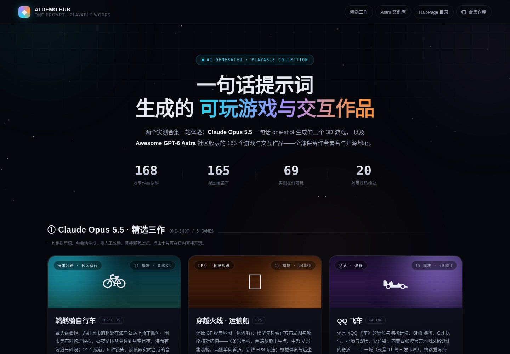
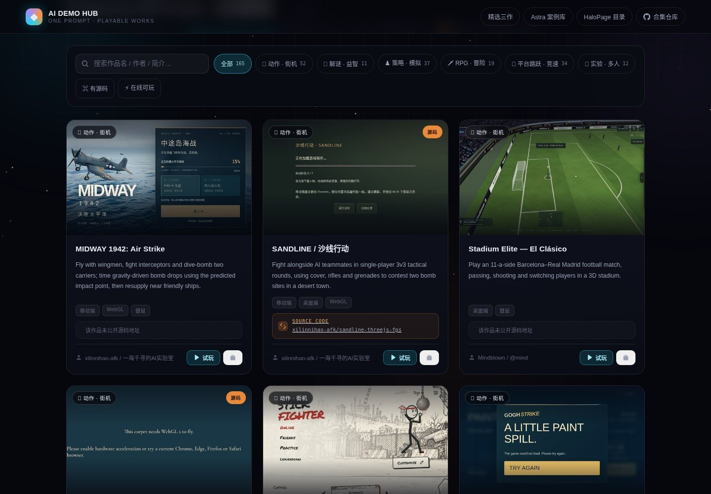
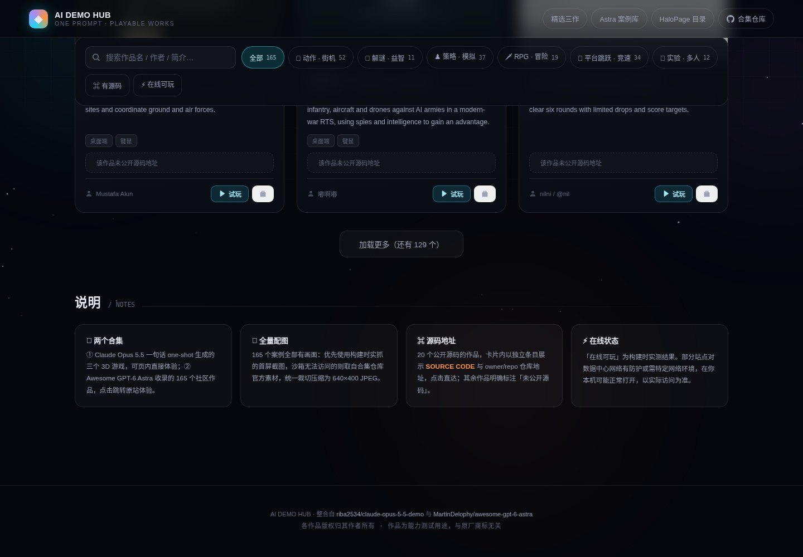

# AI Demo Hub · 提示词生成作品展示门户

一个纯静态的单页展示门户，汇集 **175 个作品**——精选 7 款可玩体验（3 个 one-shot 小游戏 + 独立 WebGPU 作品《小王子：星辰之旅》+ 第三方开源同人复刻《INKWAVE》+ Claude Fable 5.2 视觉实验合集入口 + Claude Fable 5.1《Synesthesia》）、**Claude-Fable-5.2 类目精选 3 件**（从 76 个视觉实验中挑出，直链单文件 HTML），以及 **165 个「一句话提示词 → 游戏 / 交互作品」** 在线 Demo，带截图墙、分类筛选、搜索分页，每个作品均标注 **试玩地址 + 开源源码地址 + 实机截图**。

> 线上已部署：<https://thinkspc.fun/static/halopage/demo-hub/>

## 内容构成

| 板块 | 内容 | 数量 |
|:--|:--|--:|
| 精选体验 | Claude Opus 5.5 one-shot 三作 + 独立 WebGPU 作品 + 第三方开源同人复刻 INKWAVE + Claude Fable 5.2 合集入口 + Claude Fable 5.1《Synesthesia》 | 7 |
| Claude-Fable-5.2 类目 | 从 76 个视觉实验中精选 3 件，直链单文件 HTML，可回原站查看原始提示词 | 3 |
| Astra 案例库 | GPT-6 Astra 生成的游戏与交互作品，含分类 / 搜索 / 分页 | 165 |
| 截图墙 | 无头浏览器实机抓取 + 官方素材补齐，16:10 统一规格 | 165 |
| 源码索引 | 每个作品的开源仓库地址（点击直达 GitHub） | 20 |

## Claude-Fable-5.2 类目

从 76 个实验里挑三件，各走一条路子：**NO.002 飞艇港翻牌时刻表**（界面 / 排印）、**NO.009 正午的锦鲤池**（流体 / 生成）、**NO.020 斯克约湾上的极光**（光影 / 物理）。三张卡都直接指向原站对应的单个 HTML，不经合集页；封面取自原站官方缩略图并本地压缩存放，避免 GitHub Pages 直连慢；卡片页脚的「原始提示词」链接回合集站对应条目。要浏览全部 76 个，走精选区第 6 张卡的合集入口。

## 应用截图

### 门户首页

作品总数、截图覆盖、实测在线、附带源码地址四项统计，以及 Claude Opus 5.5 精选三作。



### Astra 案例库

165 个案例的卡片墙，每张含实机截图、平台标签、开源源码地址与试玩入口。



### 说明区块

四个来源介绍、全量截图口径、源码地址收录范围与在线状态的实测方法。



## 目录结构

```
demo-hub/
├── index.html          # 门户主页（精选 + 案例库 + 全屏 iframe 体验层）
├── astra-data.js       # 案例库数据源（165 项：名称/分类/截图/试玩/源码地址）
├── fable-keyart.jpg          # 第六张精选卡的封面（墨流实验 Suminagashi）
├── f51-synesthesia.jpg       # 第七张精选卡的封面（实机抓取的流体画面）
├── f52-002-aerodrome.jpg     # Claude-Fable-5.2 类目 · NO.002 封面
├── f52-009-koi-pond.jpg      # Claude-Fable-5.2 类目 · NO.009 封面
├── f52-020-aurora.jpg        # Claude-Fable-5.2 类目 · NO.020 封面
├── prince-keyart.jpg         # 第四张精选卡的封面
└── shots/                    # 165 张作品截图（JPEG，约 5.2MB）
```

## 本地预览

```bash
cd demo-hub
python3 -m http.server 8000
# 打开 http://localhost:8000/
```

无构建步骤、无后端依赖，任意静态目录（Halo / 1Panel / Nginx / GitHub Pages）可直接部署。

本仓库根目录另有 `PickleballLeague/`、`EatHelper/`、`Yunzhou/`、`soul-init/`、`requirement-workbench/`
五个独立静态小项目，以及根 `index.html` 索引页与 `docs-screenshots/` 界面截图，
详见仓库根 [`README.md`](../README.md)。


## 部署

```bash
# 以 Halo 为例：把 demo-hub/ 放入站点静态目录
/path/to/site/static/demo-hub/
# 访问 https://你的域名/static/demo-hub/
```

## 数据来源

- 精选三作：[riba2534/claude-opus-5-5-demo](https://github.com/riba2534/claude-opus-5-5-demo)
- Astra 案例库：[MartinDelophy/awesome-gpt-6-astra](https://github.com/MartinDelophy/awesome-gpt-6-astra)
- INKWAVE（第三方开源，非 AI 生成）：[jaydendavisnc/inkwave](https://github.com/jaydendavisnc/inkwave) · 同人玩法复刻，非任天堂官方作品
- Claude Fable 5.1《Synesthesia》（实时流体 + 生成式音乐）：[MiaAI-Lab/Claude-Fable-5.1-Beautiful-HTML](https://github.com/MiaAI-Lab/Claude-Fable-5.1-Beautiful-HTML) · <https://miaai-lab.github.io/Claude-Fable-5.1-Beautiful-HTML/>
- Claude Fable 5.2（76 个视觉实验）：[MiaAI-Lab/Claude-Fable-5.2-HTML-Files](https://github.com/MiaAI-Lab/Claude-Fable-5.2-HTML-Files) · <https://miaai-lab.github.io/Claude-Fable-5.2-HTML-Files/>；NO.002 / 009 / 020 三件在类目区单独成卡并直链单文件，其余通过第 6 张精选卡的合集入口访问，均不计入 165 项 Astra 案例库
- 截图除实机抓取外，部分取自上游仓库官方素材，版权归原仓库作者所有
