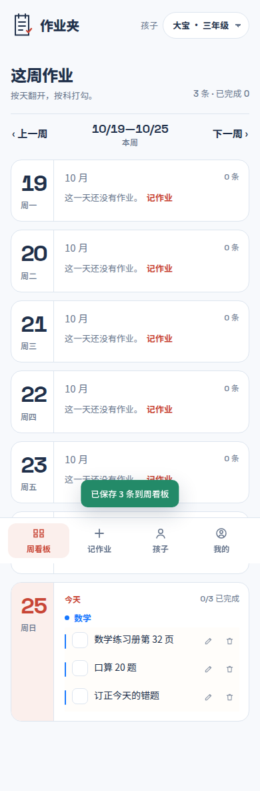
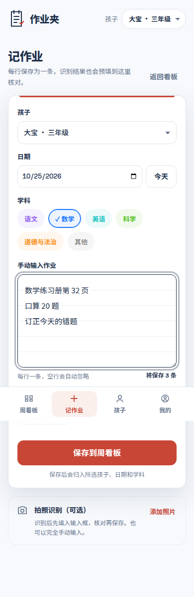
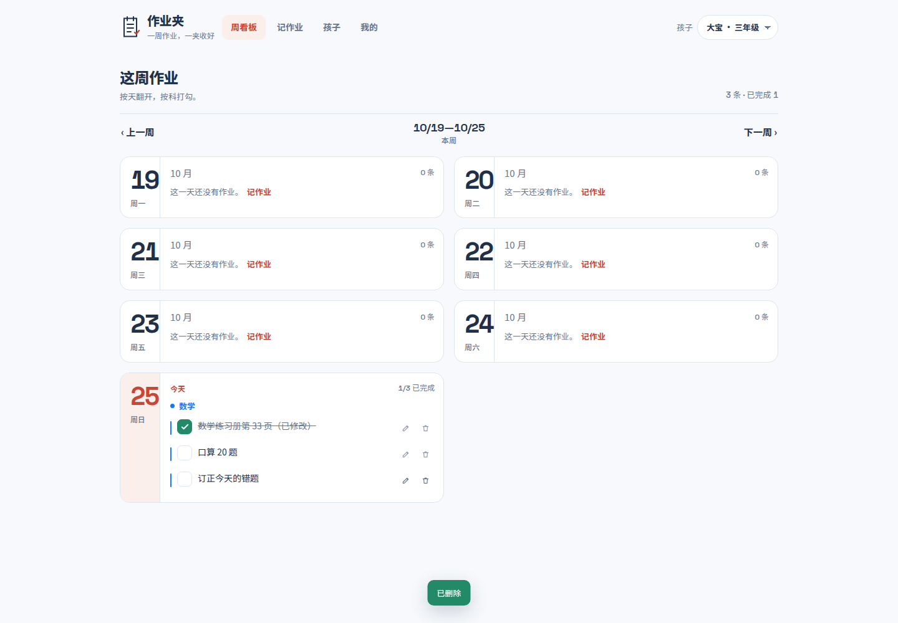

# 作业夹 · Homework Tracker

面向家长的多孩子作业记录应用：**拍照识别或逐行手动输入，按「每周 → 每天 → 学科」一屏看清，完成后打勾。**

> ⚠️ 本目录是**全栈应用**（Vue 3 + Node.js + SQLite），与 HaloPage 中其他纯静态项目不同：需要运行 Node 后端，不能只复制 `index.html`。



| 手动输入作业 | 桌面周看板 |
|:--|:--|
|  |  |

---

## 功能

| 模块 | 说明 |
|------|------|
| 账号系统 | 邮箱/手机号 + 密码注册登录；bcrypt 哈希；JWT 双 Token（access 2h + refresh 7d 轮换） |
| 多孩子档案 | 单账号最多 10 个孩子，数据按 `user_id` 完全隔离，可快速切换 |
| 周看板 | ISO 周（周一起点）× 7 天 × 学科分组；今天高亮、完成计数、上下周切换 |
| **手动批量录入** | 大输入框**每行一条**，实时显示条数；选择孩子/日期/学科后一次保存多条（事务接口） |
| 拍照识别 | 手机直调相机；客户端压缩（长边 ≤1600px）；识别结果只**预填**到输入框，人工核对后入库 |
| 识别降级链 | Qwen-VL（DashScope）→ 任意 OpenAI 兼容端点 → 失败转手动录入；照片保留，流程不断点 |
| 编辑与删除 | 单条编辑、软删除（二次确认）；所有查询强制 `user_id` 过滤，防水平越权 |
| 完成标记 | 勾选后划线、计数同步；刷新后保持 |
| 隐私与合规 | 注册强制勾选协议；隐私政策含儿童个人信息保护专章；孩子档案不要求真实姓名 |
| 运营后台 | `/admin` 管理令牌登录：统计、用户禁启用、识别调用汇总、反馈列表 |

## 技术栈

- **前端**：Vue 3 + Vite + Pinia + Vue Router（Hash 模式）
- **设计系统**：「作业夹」自有令牌（`src/styles/tokens.css`），**不使用 UI 框架**；Noto Sans SC + Space Grotesk
- **后端**：Node.js 22 + Express 5 + `node:sqlite`（Node 内置，无外部数据库）
- **鉴权**：JWT 双 Token；Token 支持 `X-Auth-Token` / `?token=` / `Authorization` 三通道（适配会改写标准头的网关）
- **识别**：Provider 抽象 + 降级链 + 调用审计（`recognition_tasks`）
- **上传**：multer 内存缓冲 + MIME/魔数双重校验；照片按 `homework/{userId}/{date}/` 隔离

## 架构

```text
Vue 3 SPA (移动优先)
   │  /api/v1  (X-Auth-Token)
   ▼
Express 5 ── JWT 中间件 ── 路由
   ├── auth / children / homeworks / upload / admin
   ├── recognition.js ── Qwen-VL → OpenAI 兼容 → 手动兜底
   └── node:sqlite (WAL) ── data/homework.db
                              └── uploads/ 照片
```

## 快速开始

要求：**Node.js 22+**（使用内置 `node:sqlite`）。

```bash
cd app/server
cp .env.example .env          # 修改 JWT_SECRET、ADMIN_TOKEN
npm install

cd ../client
npm install
npm run build
cp -r dist ../server/public   # 单端口托管前端

cd ../server
node src/index.js             # http://localhost:3000
```

前后端分离开发：

```bash
# 终端 1
cd app/server && node src/index.js

# 终端 2（Vite 代理 /api 到 3000）
cd app/client && npm run dev
```

## 环境变量

| 变量 | 默认 | 说明 |
|------|------|------|
| `PORT` | `3000` | 服务端口 |
| `JWT_SECRET` | 开发占位值 | **生产必须替换**为随机长串 |
| `ACCESS_TOKEN_TTL` | `2h` | 访问令牌有效期 |
| `REFRESH_TOKEN_TTL_DAYS` | `7` | 刷新令牌天数 |
| `DB_FILE` | `server/data/homework.db` | SQLite 文件路径 |
| `UPLOAD_DIR` | `server/uploads` | 照片目录 |
| `MAX_UPLOAD_BYTES` | `5242880` | 单张照片上限（5 MB） |
| `ADMIN_TOKEN` | 开发占位值 | 运营后台令牌，**生产必须替换** |
| `LLM_PRIMARY_BASE_URL` | DashScope 兼容端点 | 识别主链路 |
| `LLM_PRIMARY_API_KEY` | 空 | 未配置时识别自动降级为手动录入 |
| `LLM_PRIMARY_MODEL` | `qwen-vl-max` | 多模态模型名 |
| `LLM_BACKUP_*` | 空 | 备用 OpenAI 兼容端点 |
| `LLM_TIMEOUT_MS` | `25000` | 单次识别超时 |

## 目录结构

```text
homework-tracker/
├── app/
│   ├── server/                 # Node 后端
│   │   ├── src/                # config / db / auth / recognition / routes-* / index
│   │   ├── package.json
│   │   └── .env.example
│   └── client/                 # Vue 3 前端
│       ├── src/
│       │   ├── views/          # Login / WeekView / Record / Children / Profile / Policy / Admin
│       │   ├── components/     # BaseModal / ConfirmHost / ToastHost / BrandMark
│       │   ├── composables/    # useToast / useConfirm
│       │   ├── styles/         # tokens.css + app.css
│       │   ├── stores/         # auth / family
│       │   └── api/            # axios（自动刷新 + 三通道 Token）
│       └── vite.config.js
├── docs/                       # 需求 → 产品 → 技术 → 测试 → 发布 → 运维 → 运营（7 份）
├── design/                     # 视觉方案、可交互原型、上线截图
├── 全栈系统交付全案.md          # 五阶段整合报告 + 实测结论
├── 项目档案.md                  # 阶段状态、迭代记录、决策留痕
└── README.md
```

## 主要接口

| 方法 | 路径 | 说明 |
|------|------|------|
| POST | `/api/v1/auth/register` | 注册（需同意协议） |
| POST | `/api/v1/auth/login` | 登录（限流） |
| POST | `/api/v1/auth/refresh` | 刷新令牌（轮换） |
| GET | `/api/v1/children` | 孩子列表 |
| GET | `/api/v1/subjects` | 学科列表（系统预设 + 自定义） |
| GET | `/api/v1/homeworks/week-view` | 周看板（7 天 × 学科分组） |
| POST | `/api/v1/homeworks/batch` | **批量手动录入**（事务，1–50 条） |
| PUT | `/api/v1/homeworks/:id` | 编辑 / 完成标记 |
| POST | `/api/v1/homeworks/:id/recognize` | 触发识别（幂等 + 同图复用） |
| POST | `/api/v1/upload/photo` | 上传照片（压缩后） |
| GET | `/api/v1/photos/{key}` | 读取照片（归属校验） |
| GET | `/api/v1/admin/stats` | 运营统计（`x-admin-token`） |

## 数据与隐私

- 仓库**不包含** `.env`、`data/`（SQLite）、`uploads/`（孩子作业照片）、`node_modules/`、`dist/`。
- 孩子档案只要求称呼与年级，不采集真实姓名、学校、生日、面部照片。
- 照片默认存本机 `uploads/`；生产建议替换为对象存储并保留归属校验。
- 公网部署必须启用 **HTTPS**（否则手机相机权限会被浏览器拦截）；面向中国大陆用户需完成 ICP 备案。
- 识别结果绝不自动入库；必须人工核对后保存。

## 设计系统（作业夹）

| 角色 | 值 |
|------|----|
| 页面底色 | `#F7F9FC` 冷纸白 |
| 主文字 | `#20304A` 墨蓝 |
| 关键行动 | `#C84636` 红笔色（保存、今天、确认） |
| 完成状态 | `#238A68` 墨绿 |
| 中文 | Noto Sans SC（400/500/700/800） |
| 数字 | Space Grotesk（日期、周范围、计数） |

结构来自课程表，分类来自学科标签，红笔只承担动作语义；唯一强视觉元素是周看板的大号日期数字。

## 测试

- 公网生产构建实测：注册 → 建档 → **三行批量录入** → 看板回显 3 条 → 完成勾选 → 编辑回写 → 照片识别降级 → 删除确认，**9 项通过、JS 错误 0**。
- 加载容错：周视图 15s 超时、失败自动重试一次、失败显示「重新加载」卡片，不再无限骨架屏。
- 构建体积：主包约 104 KB（gzip 39 KB），全站产物 256 KB。

## 文档

- [需求与平台选型](docs/phase1/01-需求与平台选型报告.md)
- [产品定义与 PRD](docs/phase1/02-产品定义方案.md)
- [技术研发方案](docs/phase1/03-技术研发方案.md)
- [测试保障方案](docs/phase2/01-测试保障方案.md)
- [上线发布方案](docs/phase3/01-上线发布方案.md)
- [运维保障方案](docs/phase4/01-运维保障方案.md)
- [运营增长方案](docs/phase5/01-运营增长方案.md)
- [全栈系统交付全案](全栈系统交付全案.md)

## 已知限制

- 短信验证码登录未接入；学科自定义目前仅 API 支持，前端入口待补。
- 未做小程序/App 端；SQLite 适合家庭级规模，高并发需换 MySQL。
- 未配置识别 Key 时拍照识别不可用，但手动录入完整可用。
- 演示地址与访问凭据不在仓库公开。

## 许可

本目录代码可自由参考与二次开发；第三方依赖遵循各自许可证。AI 识别服务由第三方提供，使用前请阅读其条款。
